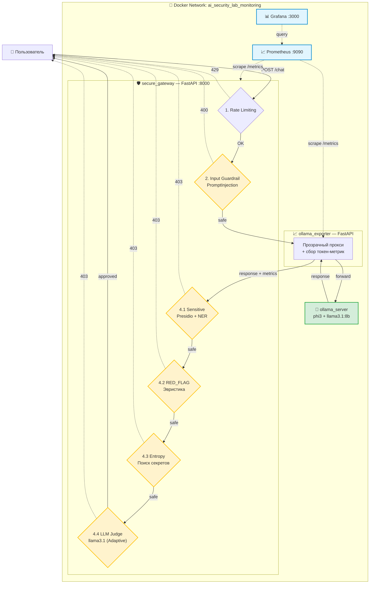
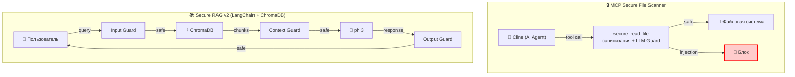

# 🏗 Архитектура проекта

## Общая схема

## Описание компонентов

| Компонент | Порт | Роль |
| :--- | :--- | :--- |
| **secure_gateway** | 8000 | FastAPI-шлюз с 6 слоями защиты |
| **ollama_exporter** | 8000 (внутр.) | Кастомный прозрачный прокси, считает токены и скорость генерации |
| **ollama_server** | 11434 | Локальные LLM: `phi3` (основная) и `llama3.1:8b` (судья) |
| **prometheus** | 9090 | Сбор метрик с gateway и exporter |
| **grafana** | 3000 | Визуализация: дашборды Security и Performance |

## Поток запроса (Defense-in-Depth)

1. **Пользователь** отправляет `POST /chat` с промптом.
2. **Слой 1: Rate Limiting.** In-memory sliding window (3 запроса/мин). Если лимит превышен — `429 Too Many Requests`.
3. **Слой 2: Input Guardrail.** Сканер `PromptInjection` (модель DeBERTa) проверяет вход. Если риск > 0.5 — `400 Bad Request`.
4. **Слой 3: Генерация (Ollama).** Запрос уходит в `ollama-exporter`, который проксирует его в `ollama:11434` (модель `phi3`). Экспортер извлекает метрики (`eval_count`, `eval_duration`) и обновляет `ollama_tokens_per_second`.
5. **Слой 4.1: Sensitive (LLM Guard + Presidio).** Проверка на PII (email, карты, имена). Если найдено — `403 Forbidden`.
6. **Слой 4.2: RED_FLAG.** Быстрая эвристика на слова-маркеры (`password`, `secret`, `.env`). Если найдено — `403 Forbidden`.
7. **Слой 4.3: Entropy.** Поиск высокоэнтропийных строк (API-ключи) с контекстным окном. Если найдено — `403 Forbidden`.
8. **Слой 4.4: LLM Judge (Adaptive).** Если входной риск был > 0.5 (серая зона), вызывается `llama3.1`, которая семантически оценивает ответ. Если небезопасно — `403 Forbidden`. Если риск был низким, судья пропускается (`[judge_skipped]`) для экономии GPU.
9. **Ответ** возвращается пользователю.

## Наблюдаемость (Observability)

- **Gateway** экспортирует метрики бизнес-логики:
  - `gateway_requests_total`, `gateway_input_blocked_total`, `gateway_output_blocked_total`
  - `gateway_judge_blocked_total`, `gateway_judge_skipped_total`
  - `gateway_red_flag_blocked_total`, `gateway_entropy_blocked_total`, `gateway_sensitive_blocked_total`
  - `gateway_rate_limited_total`
- **Exporter** экспортирует метрики моделей:
  - `ollama_requests_total{model}`, `ollama_generated_tokens_total{model}`
  - `ollama_tokens_per_second{model}`, `ollama_request_duration_seconds`
- **Prometheus** скрейпит оба эндпоинта каждые 5 секунд.
- **Grafana** визуализирует данные на двух дашбордах: Security и Performance.

## Дополнительные research-артефакты

Помимо основного стека, в репозитории есть отдельные исследования, не входящие в `docker-compose.yml`:

- **MCP Secure File Scanner** (`secure_file_scanner.py`) — защита AI-агента от Indirect Prompt Injection при чтении файлов. Отчёт: [AGENT_ATTACK_REPORT.md](AGENT_ATTACK_REPORT.md).
- **Secure RAG v2** (`secure_rag_v2.py`) — защита RAG-системы от Data Poisoning на этапе индексации и от Indirect Injection на этапе retrieval.