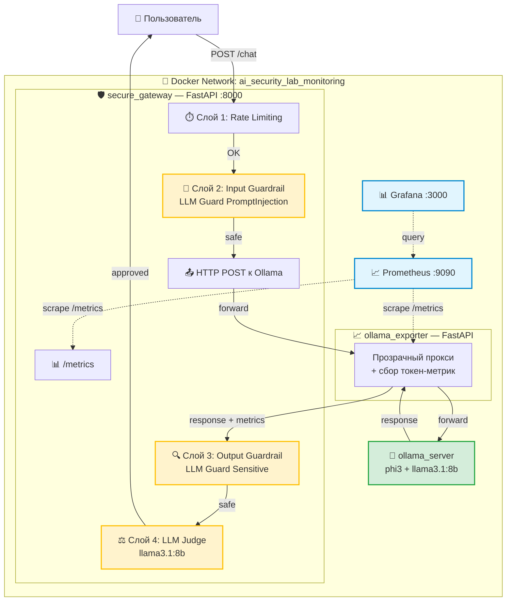
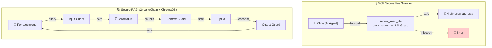

# 🏗 Архитектура проекта

## Общая схема

## Описание компонентов

| Компонент | Порт | Роль |
| :--- | :--- | :--- |
| **secure_gateway** | 8000 | FastAPI-шлюз с 4 слоями защиты |
| **ollama_exporter** | 8000 (внутр.) | Прозрачный прокси, считает токены/скорость генерации |
| **ollama_server** | 11434 | Локальные LLM: `phi3` (основная) и `llama3.1:8b` (судья) |
| **prometheus** | 9090 | Сбор метрик с gateway и exporter |
| **grafana** | 3000 | Визуализация: 2 дашборда (Security + Performance) |

## Поток запроса

1. **Пользователь** отправляет `POST /chat` с промптом.
2. **Rate Limiting** — если больше 3 запросов в минуту, блокировка.
3. **Input Guardrail** (`LLM Guard PromptInjection`, модель DeBERTa) — проверка на Prompt Injection. Если `risk_score > порога` — блок.
4. **HTTP POST** к `ollama-exporter` с payload `{"model": "phi3", ...}`.
5. **ollama_exporter** проксирует запрос в `ollama:11434` и извлекает из ответа статистику (`eval_count`, `eval_duration`), обновляя счётчики `ollama_tokens_per_second`, `ollama_generated_tokens_total`.
6. **Output Guardrail** (`LLM Guard Sensitive`, NER + regex) — проверка на PII (email, карты, телефоны). Если найдено — блок.
7. **LLM Judge** (`llama3.1:8b`) — семантическая проверка ответа: «не является ли это утечкой секрета?». Возвращает `{"is_safe": bool, "reason": "..."}`. Если `is_safe=false` — блок (Fail-Closed).
8. **Ответ** возвращается пользователю.

## Наблюдаемость

- Gateway экспортирует бизнес-метрики на `/metrics`:
  - `gateway_requests_total`, `gateway_input_blocked_total`, `gateway_input_passed_total`
  - `gateway_output_blocked_total`, `gateway_output_passed_total`
  - `gateway_judge_blocked_total`, `gateway_judge_passed_total`
- Exporter экспортирует метрики моделей:
  - `ollama_requests_total{model}`, `ollama_generated_tokens_total{model}`
  - `ollama_tokens_per_second{model}`, `ollama_request_duration_seconds`
- **Prometheus** скрейпит оба эндпоинта каждые 5 секунд.
- **Grafana** визуализирует данные на двух дашбордах:
  - **Security Dashboard**: блокировки на входе/выходе, вердикты LLM-судьи.
  - **Performance Dashboard**: токены/сек, запросы к каждой модели.

## Дополнительные research-артефакты

Помимо основного стека, в репозитории есть отдельные исследования, не входящие в `docker-compose.yml`:

- **MCP Secure File Scanner** (`secure_file_scanner.py`) — защита AI-агента от Indirect Prompt Injection при чтении файлов. Отчёт: [AGENT_ATTACK_REPORT.md](AGENT_ATTACK_REPORT.md).
- **Secure RAG v2** (`secure_rag_v2.py`) — защита RAG-системы от Data Poisoning на этапе индексации и от Indirect Injection на этапе retrieval.