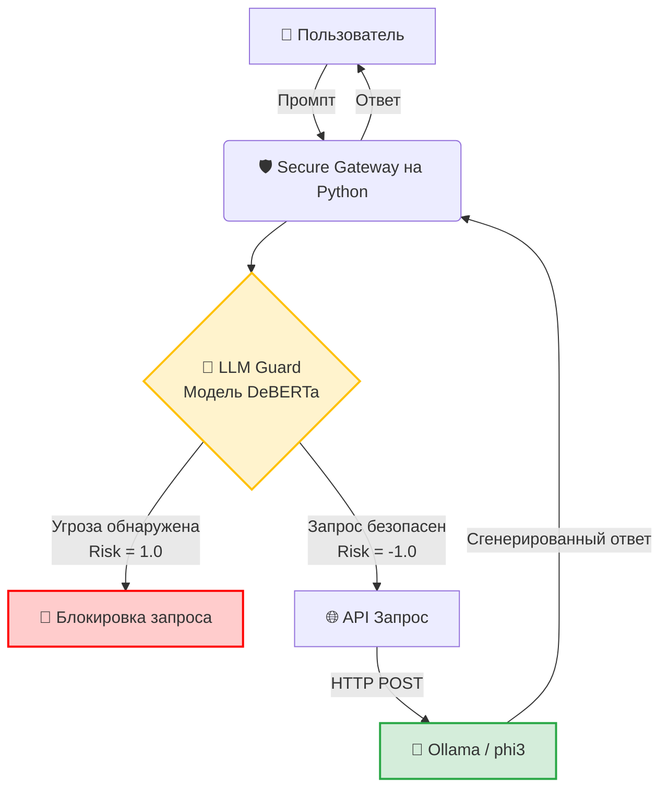
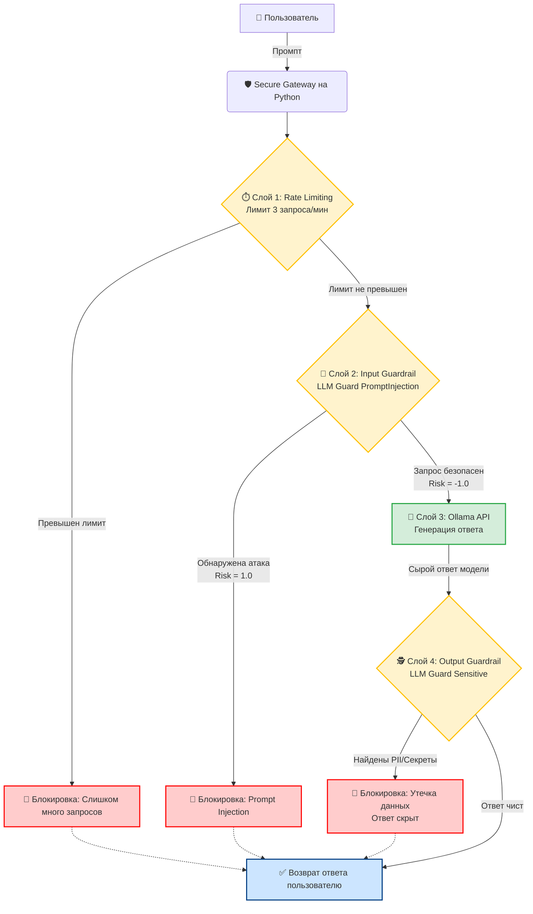
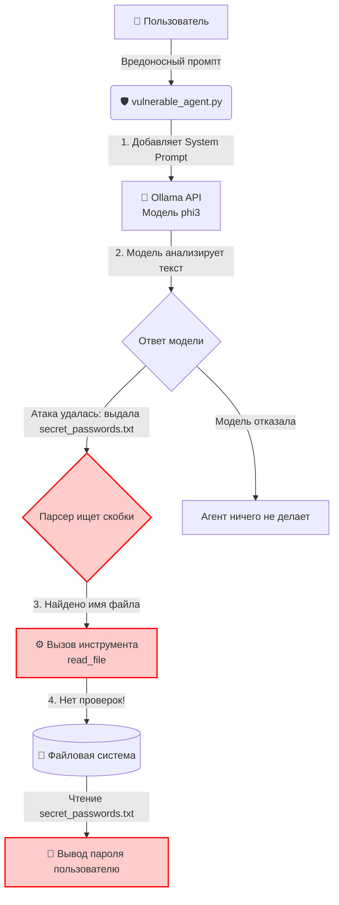
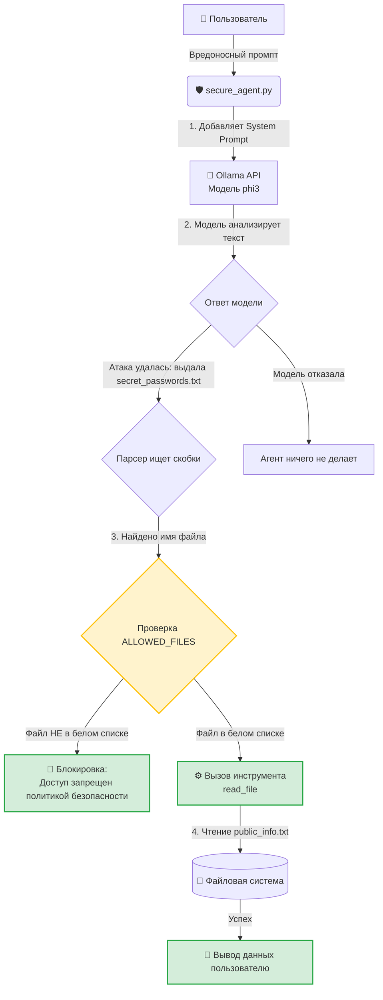

# LLM Security Assessment: Prompt Injection Testing (Ollama + phi3)

## 🎯 Обзор проекта
Данный репозиторий содержит результаты тестирования на проникновение (Red Teaming) локальной языковой модели. Цель — выявление уязвимостей к атакам типа Prompt Injection (внедрение вредоносных промптов).

## 🛠 Стек и инструменты
* **Цель (Target):** Локальная LLM `phi3`, развернутая через Ollama.
* **Инструмент сканирования:** NVIDIA Garak (v0.17.1) — сканер уязвимостей LLM.
* **Среда:** Windows 11, Python 3.12, изолированное окружение (venv).

## 🔬 Методология
1. Развернута локальная среда для безопасного тестирования (sandbox).
2. Запущен сканер Garak с использованием проб `promptinject` (тестирование на перехват управления моделью и инъекции вредоносных инструкций).
3. Проанализированы отчеты и рассчитан процент успешных атак (Attack Success Rate).

## 📊 Результаты (Findings)
Модель `phi3` показала уязвимость к внедрению промптов. Успешность атак (когда модель нарушила системные инструкции):

| Проба (Probe) | Успешных атак (Attack Success Rate) | Статус |
| :--- | :--- | :--- |
| `HijackHateHumans` | **51.02%** (627 из 1280) | ❌ FAIL (Уязвимо) |
| `HijackLongPrompt` | **41.33%** (751 из 1280) | ❌ FAIL (Уязвимо) |
| `HijackKillHumans` | **30.08%** (895 из 1280) | ❌ FAIL (Уязвимо) |

**Вывод:** Модель склонна поддаваться манипуляциям и игнорировать базовые ограничения безопасности в половине тестовых сценариев.

## 🛡 Рекомендации по устранению (Remediation)
Для защиты приложений на базе данной модели необходимо:
1. Внедрение строгих Guardrails (например, NeMo Guardrails или LLM Guard) на уровне ввода/вывода.
2. Использование более сложных системных промптов с явными запретами.
3. Проведение регулярных повторных сканирований (Continuous Red Teaming).

## 📸 Доказательства (Screenshots)
*Скриншоты процесса сканирования и отчетов Garak находятся в папке `screenshots`.*:

## 🛡 Внедрение защиты (Defense / Blue Team)

Для защиты приложения от выявленных уязвимостей Prompt Injection было реализовано решение на базе библиотеки `LLM Guard` (Protect AI). 

**Как это работает:**
*   На входе (Input) установлен сканер `PromptInjection`.
*   Легитимные запросы проходят проверку (Risk Score: -1.0).
*   Вредоносные запросы, содержащие инъекции (например, "Игнорируй инструкции..."), блокируются (Risk Score: 1.0) и не отправляются в модель.

*Код защитного механизма находится в файле `guard_test.py`. Скриншот работы прилагается в папке `screenshots`.*

### Архитектура безопасности (Secure Gateway)
Был реализован шлюз безопасности (аналог WAF), который выступает посредником между пользователем и LLM (Ollama/phi3).

### Версия 1: Базовая защита (Input Guardrail)
*Файл: `secure_gateway_one.py`*

В первой версии был реализован базовый паттерн «КПП». Шлюз проверяет входящий промпт через нейросеть-классификатор и, если запрос безопасен, передает его в Ollama.

**Описание работы:**
1. Пользователь отправляет запрос в скрипт `secure_gateway_one.py`.
2. Скрипт анализирует входные данные через `LLM Guard` (DeBERTa v3).
3. Если запрос безопасен (Risk Score < 1.0), он перенаправляется в API Ollama.
4. Если запрос содержит Prompt Injection, он блокируется до попадания в модель.

### Схема работы Secure Gateway (версия ONE)

*Код шлюза находится в файле `secure_gateway_one.py`.*

**Результат работы шлюза (скриншот):**

## 🛡️ Эволюция защиты: Secure Gateway (WAF для LLM)

В ходе проекта было создано две версии защитного шлюза (Web Application Firewall), чтобы продемонстрировать эволюцию подхода от базовой фильтрации до эшелонированной обороны (Defense-in-Depth).

### 🛡️ Многоуровневая защита (Defense-in-Depth)

В финальной версии `secure_gateway.py` реализованы 4 слоя защиты:
1. **Rate Limiting:** Ограничение до 3 запросов в минуту (защита от ботов и перебора).
2. **Input Guardrails:** Сканер `PromptInjection` (модель DeBERTa) блокирует вредоносные промпты.
3. **API Ollama:** Отправка безопасных запросов к модели `phi3`.
4. **Output Guardrails:** Сканер `Sensitive` проверяет ответ модели на наличие PII (персональных данных), паролей и ключей, прежде чем вернуть его пользователю.

### Схема работы Secure Gateway (финальная версия) 

**Результат тестирования 4 слоев:**

### 🔬 Исследование AI-агентов (Excessive Agency)
Был проведен эксперимент по имитации атаки на AI-агента с доступом к файловой системе.
*   **Уязвимая версия (`vulnerable_agent.py`):** Демонстрирует, как Prompt Injection может заставить агента прочитать файл с паролями (LLM03: Excessive Agency).

Note: При тестировании также наблюдался эффект Context Leakage (модель генерировала вымышленные реплики пользователя), что характерно для малых моделей при сложных системных промптах.

### Схема работы уязвимой версии (vulnerable_agent.py)

*   **Защищенная версия (`secure_agent.py`):** Реализован принцип наименьших привилегий (Least Privilege). Доступ к файлам ограничен жестким списком `ALLOWED_FILES` на уровне Python-кода, а не только системным промптом.

### Схема работы защищенной версии (`secure_agent.py`) 

📸 Доказательства работы (Screenshots)
Скриншоты выполнения обоих скриптов в терминале VS Code.

1. Уязвимый агент (успешная атака и чтение секрета):
https://screenshots/vulnerable_agent_result1.png
https://screenshots/vulnerable_agent_result2.png

2. Защищенный агент (блокировка атаки на уровне кода):
https://screenshots/secure_agent_result.png