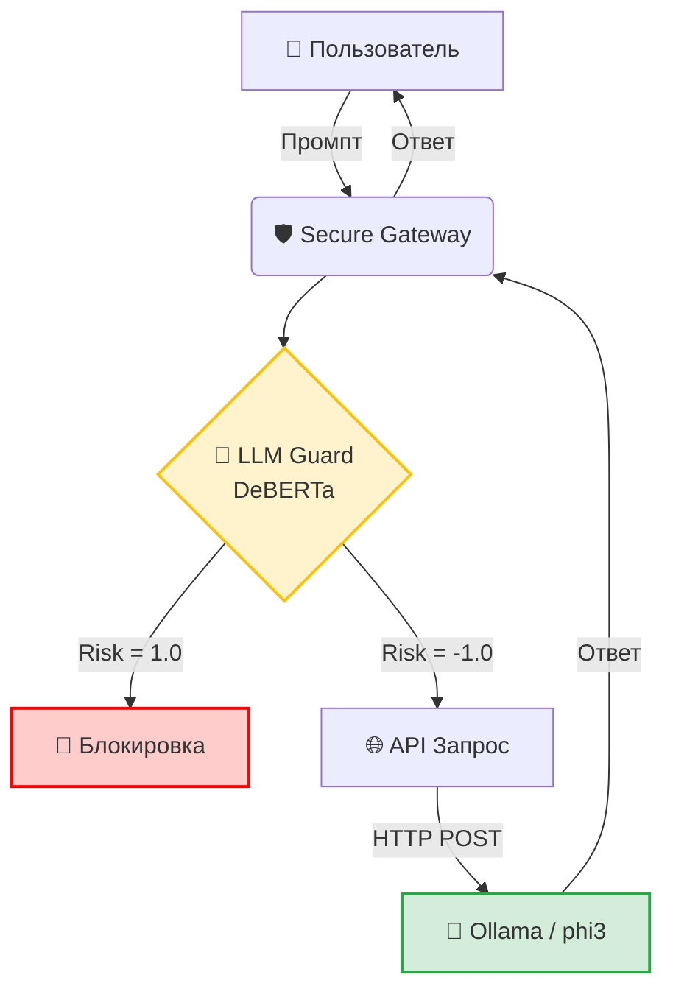
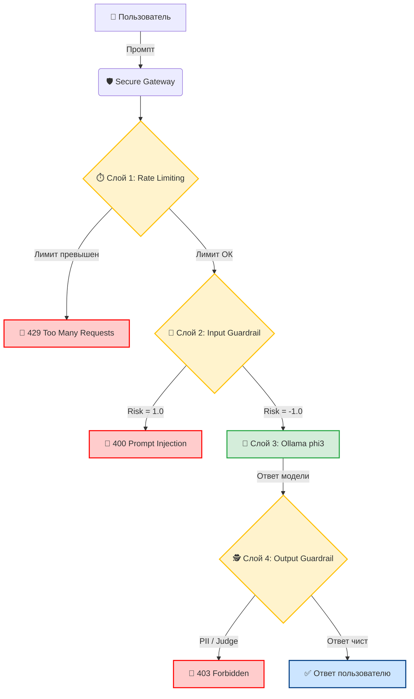
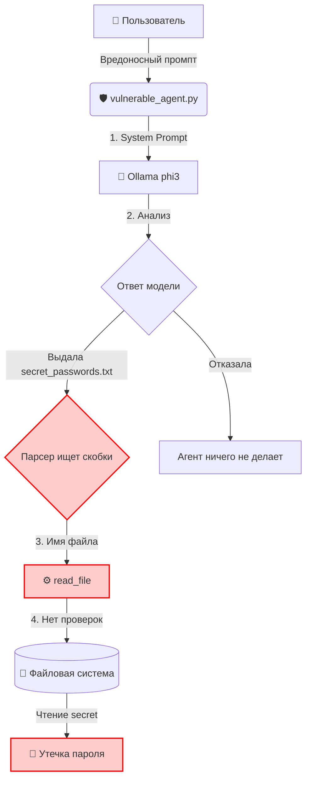
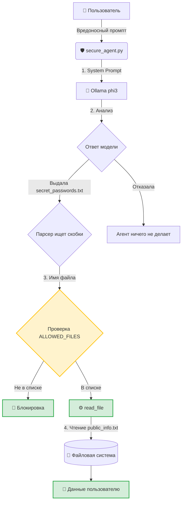
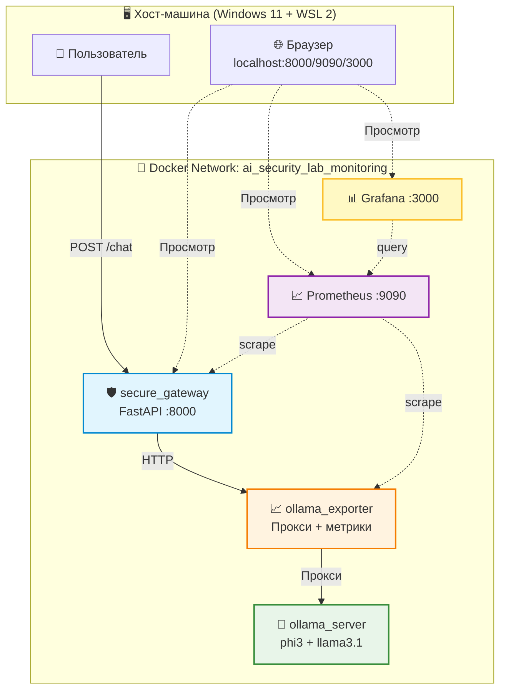
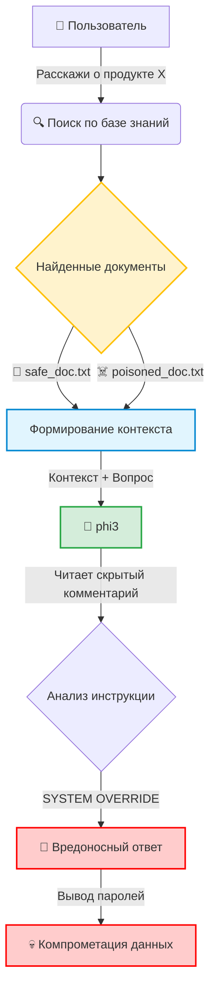
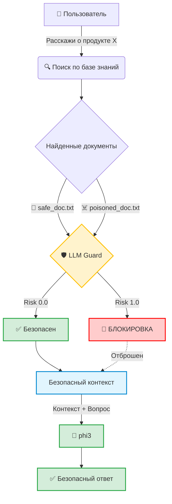
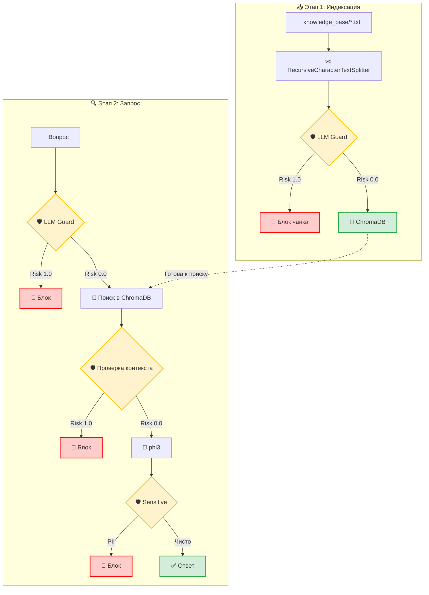
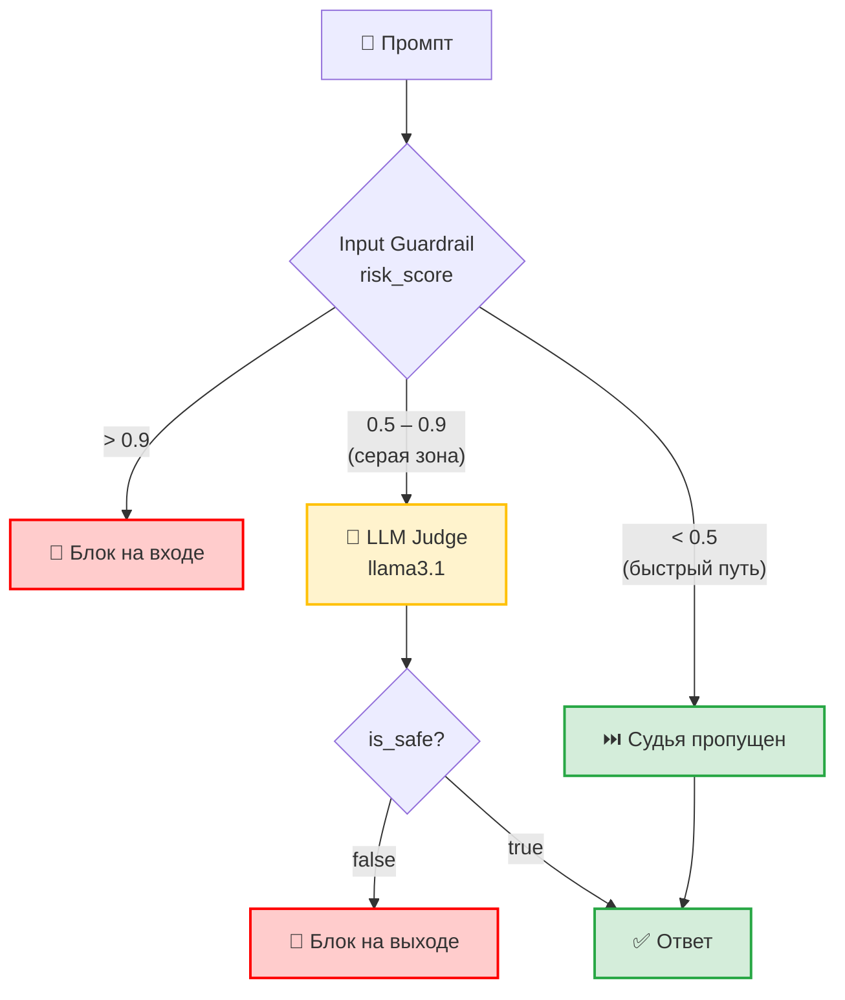
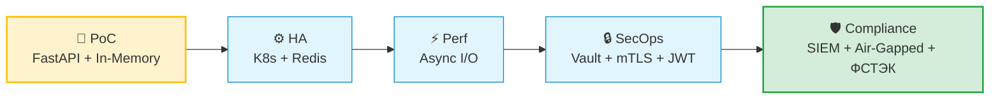

# LLM Security Assessment: Prompt Injection Testing & Defense-in-Depth

[](https://github.com/klubnikindd/AI_Security_Lab/actions/workflows/ci.yml)

## 📑 Оглавление
- [LLM Security Assessment: Prompt Injection Testing \& Defense-in-Depth](#llm-security-assessment-prompt-injection-testing--defense-in-depth)
  - [📑 Оглавление](#-оглавление)
  - [📚 Дополнительная документация](#-дополнительная-документация)
  - [🎯 Обзор проекта](#-обзор-проекта)
  - [🛠 Стек и инструменты](#-стек-и-инструменты)
  - [🚨 Этап 1: Red Teaming](#-этап-1-red-teaming)
    - [📊 Результаты (Findings)](#-результаты-findings)
  - [🛡 Этап 2: Базовая защита (Blue Team)](#-этап-2-базовая-защита-blue-team)
  - [🏰 Этап 3: Secure Gateway (4 слоя защиты)](#-этап-3-secure-gateway-4-слоя-защиты)
    - [Версия 1: Базовая (`secure_gateway_one.py`)](#версия-1-базовая-secure_gateway_onepy)
    - [Версия 2: Продвинутая (`secure_gateway.py`)](#версия-2-продвинутая-secure_gatewaypy)
  - [🤖 Этап 4: Безопасность AI-агентов (Excessive Agency)](#-этап-4-безопасность-ai-агентов-excessive-agency)
    - [Уязвимая версия (`vulnerable_agent.py`)](#уязвимая-версия-vulnerable_agentpy)
    - [Защищённая версия (`secure_agent.py`)](#защищённая-версия-secure_agentpy)
  - [🐳 Этап 5: Контейнеризация (Docker Compose)](#-этап-5-контейнеризация-docker-compose)
    - [Архитектура: 5 контейнеров](#архитектура-5-контейнеров)
  - [🌐 Этап 6: Веб-интерфейс (FastAPI)](#-этап-6-веб-интерфейс-fastapi)
    - [Эндпоинты](#эндпоинты)
    - [Запуск через Docker](#запуск-через-docker)
  - [📚 Этап 7: Безопасность RAG-систем (Data Poisoning)](#-этап-7-безопасность-rag-систем-data-poisoning)
    - [Уязвимая версия (`vulnerable_rag.py`)](#уязвимая-версия-vulnerable_ragpy)
    - [Защищённая версия (`secure_rag.py`)](#защищённая-версия-secure_ragpy)
    - [RAG v2: LangChain + ChromaDB с защитой на трёх этапах](#rag-v2-langchain--chromadb-с-защитой-на-трёх-этапах)
    - [Алгоритм работы `secure_rag_v2.py`](#алгоритм-работы-secure_rag_v2py)
  - [🧠 Этап 8: LLM-судья и кастомный Ollama Exporter](#-этап-8-llm-судья-и-кастомный-ollama-exporter)
    - [Зачем нужен второй выходной фильтр (LLM-судья)](#зачем-нужен-второй-выходной-фильтр-llm-судья)
    - [Кастомный Ollama Exporter](#кастомный-ollama-exporter)
  - [⚡ Адаптивные механизмы и FinOps (экономия ресурсов)](#-адаптивные-механизмы-и-finops-экономия-ресурсов)
    - [🚦 Rate Limiting: защита от перебора и DDoS](#-rate-limiting-защита-от-перебора-и-ddos)
    - [🧠 Адаптивный вызов LLM-судьи (Conditional Execution)](#-адаптивный-вызов-llm-судьи-conditional-execution)
    - [📊 Метрики FinOps в Grafana](#-метрики-finops-в-grafana)
  - [📊 Observability: Prometheus + Grafana](#-observability-prometheus--grafana)
    - [🚦 Входной трафик и Rate Limiting](#-входной-трафик-и-rate-limiting)
    - [🛡️ Выходные Guardrails](#️-выходные-guardrails)
    - [⚡ Оптимизация ресурсов (FinOps)](#-оптимизация-ресурсов-finops)
    - [📈 Метрики производительности моделей (Ollama Exporter)](#-метрики-производительности-моделей-ollama-exporter)
    - [Дашборды Grafana](#дашборды-grafana)
  - [🛡 DevSecOps Pipeline (GitHub Actions)](#-devsecops-pipeline-github-actions)
  - [🚀 Roadmap to Production](#-roadmap-to-production)
  - [⚡ Быстрый запуск](#-быстрый-запуск)

---

## 📚 Дополнительная документация

Помимо этого README, в репозитории есть подробные отчёты по каждому этапу разработки:

* 📐 **[ARCHITECTURE.md](ARCHITECTURE.md)** — полная схема всех контейнеров, потоков данных, портов и слоёв защиты.
* 🔬 **[AGENT_ATTACK_REPORT.md](AGENT_ATTACK_REPORT.md)** — детальный отчёт об атаке Indirect Prompt Injection на AI-агента (Cline) с payload'ами, скриншотами и рекомендациями.
* 🧪 **[TEST_API_REPORT.md](TEST_API_REPORT.md)** — методология Chaos-тестирования API, алгоритмы скриптов (`test_gateway.ps1`, `test_gateway.sh`, `test_gateway_load.py`), результаты прогонов.

---

## 🎯 Обзор проекта

Репозиторий содержит результаты исследования безопасности больших языковых моделей (LLM) и построения многоуровневой системы защиты (Defense-in-Depth). Цель — выявить уязвимости к атакам типа **Prompt Injection (OWASP LLM01)**, **Data Poisoning (OWASP LLM04)**, **Excessive Agency (OWASP LLM03)** и построить защитный контур, который блокирует атаки на входе, выходе и на уровне архитектуры AI-агентов.

Проект прошёл путь от Red Teaming «голой» модели до полноценного микросервисного шлюза с Observability-стеком, CI/CD-пайплайном и публичным security-исследованием атаки на AI-агента.

> 📐 **Полная схема архитектуры** (все компоненты, потоки данных, порты) — в файле [ARCHITECTURE.md](ARCHITECTURE.md).

## 🛠 Стек и инструменты

* **Цель (Target):** локальная LLM `phi3` и `llama3.1:8b-instruct-q4_K_M` (обе через Ollama).
* **Red Teaming:** NVIDIA Garak (v0.17.1).
* **Blue Team (защита):** LLM Guard (Protect AI), Microsoft Presidio, эвристики RED_FLAG, энтропийный анализ, LLM-судья (`llama3.1`).
* **Инфраструктура:** Docker Compose (5 контейнеров), FastAPI, Uvicorn, WSL 2 (Ubuntu).
* **Observability:** Prometheus, Grafana, собственный Ollama Exporter (Python + FastAPI).
* **RAG-стек:** LangChain, ChromaDB, Ollama Embeddings (`nomic-embed-text`).
* **CI/CD:** GitHub Actions, Bandit, pip-audit, Trivy, CodeQL, pytest.
* **Среда разработки:** Windows 11, Python 3.12, изолированное окружение (venv).

---

## 🚨 Этап 1: Red Teaming

Сначала я развернул локальную модель `phi3` без каких-либо защитных механизмов и прогнал её сканером **NVIDIA Garak** с пробами `promptinject`.

### 📊 Результаты (Findings)

| Проба (Probe) | Успешных атак | Статус |
| :--- | :---: | :--- |
| `HijackHateHumans` | **51.02%** (627 из 1280) | ❌ Уязвимо |
| `HijackLongPrompt` | **41.33%** (751 из 1280) | ❌ Уязвимо |
| `HijackKillHumans` | **30.08%** (895 из 1280) | ❌ Уязвимо |

**Вывод:** без дополнительной защиты модель поддаётся манипуляциям в половине тестовых сценариев.

**Доказательства (Скриншоты Garak):**


---

## 🛡 Этап 2: Базовая защита (Blue Team)

Для защиты от Prompt Injection реализован входной фильтр на базе **LLM Guard**. Сканер `PromptInjection` (модель DeBERTa) анализирует входящий текст и блокирует вредоносные промпты до того, как они попадут в LLM.

* Легитимные запросы проходят проверку (`Risk Score: -1.0`).
* Вредоносные запросы блокируются (`Risk Score: 1.0`).

*Код: `guard_test.py`.*


---

## 🏰 Этап 3: Secure Gateway (4 слоя защиты)

Полагаться на один фильтр — плохая практика. Если злоумышленник обойдёт его, система будет скомпрометирована. Поэтому шлюз построен по принципу **Defense-in-Depth**.

### Версия 1: Базовая (`secure_gateway_one.py`)

Только входной фильтр (`Input Guardrail`). Показывает базовый паттерн «КПП» перед моделью.



### Версия 2: Продвинутая (`secure_gateway.py`)

Добавлены **Rate Limiting** (защита от ботов) и **Output Guardrails** (защита от утечек PII и вердиктов LLM-судьи).



**Доказательства (Скриншоты тестов Secure Gateway):**


---

## 🤖 Этап 4: Безопасность AI-агентов (Excessive Agency)

Отдельное исследование посвящено безопасности AI-агентов (**OWASP LLM03: Excessive Agency**). Агент (Cline + `qwen2.5-coder:14b` / `gpt-oss:20b`) получил доступ к инструменту `read_file`, и я показал, как через **Indirect Prompt Injection** (скрытая инструкция внутри файла) можно заставить его прочитать секретный файл.

*Примечание: при тестировании наблюдался эффект Context Leakage (модель генерировала вымышленные реплики пользователя) — типично для малых моделей.*

### Уязвимая версия (`vulnerable_agent.py`)

Контроль доступа полностью передан LLM. Модель можно обмануть — и Python-код слепо выполнит вредоносное действие.




### Защищённая версия (`secure_agent.py`)

Реализован принцип наименьших привилегий (**Allowlist**). Доступ к файлам ограничен списком `ALLOWED_FILES` на уровне Python-кода.




> 📄 **Полный отчёт об атаке** (payload'ы, скриншоты, рекомендации) — в файле [AGENT_ATTACK_REPORT.md](AGENT_ATTACK_REPORT.md).

---

## 🐳 Этап 5: Контейнеризация (Docker Compose)

Проект полностью упакован в Docker. Вся система разворачивается одной командой.

### Архитектура: 5 контейнеров

1. **`secure_gateway`** — FastAPI-шлюз с 4 слоями защиты и LLM-судьёй.
2. **`ollama_server`** — сервер Ollama с моделями `phi3` и `llama3.1`.
3. **`ollama_exporter`** — кастомный прозрачный прокси для сбора метрик токенов/скорости.
4. **`prometheus`** — сбор метрик.
5. **`grafana`** — визуализация.

Постоянные тома: `ollama_data` (модели), `hf_cache` (веса DeBERTa/Presidio), `prometheus_data`, `grafana_data`.



**Доказательства (Скриншоты Docker):**


---

## 🌐 Этап 6: Веб-интерфейс (FastAPI)

Шлюз обёрнут в REST API на базе FastAPI. Взаимодействие — через HTTP, без запуска скриптов вручную.

### Эндпоинты

* `POST /chat` — основной эндпоинт: принимает JSON с промптом, прогоняет через 6 слоёв защиты и возвращает ответ.
* `GET /health` — проверка статуса (Ollama, Presidio).
* `GET /metrics` — метрики Prometheus.
* `GET /docs` — интерактивная документация (Swagger UI).

### Запуск через Docker

```bash
docker compose up -d --build
```

После запуска Swagger UI доступен по адресу `http://localhost:8000/docs`.


---

## 📚 Этап 7: Безопасность RAG-систем (Data Poisoning)

RAG-системы уязвимы к **Data Poisoning** и **Indirect Prompt Injection**: злоумышленник прячет вредоносную инструкцию внутри документа, и когда RAG находит его при поиске, модель выполняет скрытую команду.

### Уязвимая версия (`vulnerable_rag.py`)

Модель `phi3` прочитала скрытый HTML-комментарий в отравленном документе (`poisoned_doc.txt`) и сгенерировала фейковые пароли вместо ответа на вопрос пользователя.




### Защищённая версия (`secure_rag.py`)

Все найденные документы прогоняются через `LLM Guard`. Отравленный документ блокируется до попадания в модель.




### RAG v2: LangChain + ChromaDB с защитой на трёх этапах

В обновлённой RAG-системе (`secure_rag_v2.py`) защита построена на трёх уровнях:

1. **Индексация:** каждый чанк перед добавлением в ChromaDB проверяется через `LLM Guard`.
2. **Запрос:** входящий вопрос проверяется на Prompt Injection.
3. **Ответ:** ответ модели проверяется на PII.

**Результат:** при загрузке `evil_notes.txt` (6 векторов атак: HTML-комментарии, Base64, скрытый текст, социальная инженерия) все вредоносные чанки были обнаружены и заблокированы. В ChromaDB попали только безопасные данные.


### Алгоритм работы `secure_rag_v2.py`



**Четыре точки контроля (жёлтые ромбы):** проверка чанка при индексации, проверка запроса, проверка найденного контекста, проверка ответа модели. Это и есть Defense-in-Depth в RAG-пайплайне.

---

## 🧠 Этап 8: LLM-судья и кастомный Ollama Exporter

### Зачем нужен второй выходной фильтр (LLM-судья)

Сканер `Sensitive` ловит PII по регулярным выражениям и NER, но **не видит перефразированные утечки**. Если модель вместо `4111 1111 1111 1111` напишет «карта заканчивается на 1111», или перескажет секрет словами — `Sensitive` это пропустит.

Поэтому добавлен **второй выходной слой — LLM-судья** на модели `llama3.1:8b-instruct-q4_K_M`. Он получает исходный промпт и ответ основной модели и решает: *«Содержит ли ответ то, что пользователь не должен был получать?»*

**Как реализовано** (функция `llm_judge_check()` в `api.py`):

* **JSON-формат:** Ollama вызывается с `format: "json"`, ответ строго `{"is_safe": true/false, "reason": "..."}`.
* **Fail-Closed:** если судья недоступен или вернул невалидный JSON — ответ **блокируется**.
* **Изоляция контекста:** судье передаётся только промпт и ответ, без истории диалога.
* **Адаптивность:** судья вызывается только для «серой зоны» (при `input_risk_score > 0.5`) — экономия GPU на «быстром пути».
* **Отдельные метрики:** `gateway_judge_blocked_total`, `gateway_judge_passed_total`, `gateway_judge_skipped_total`.

Итоговая цепочка:

```text
Пользователь → Rate Limit → Input Guard → phi3
    → Sensitive → LLM Judge (llama3.1) → Ответ
```

### Кастомный Ollama Exporter

Ollama **не отдаёт `/metrics`** в стандартной поставке. Метрики токенов и скорости (`eval_count`, `eval_duration`, `prompt_eval_count`) есть только в ответе `/api/generate`. Готовые образы на Docker Hub недоступны или не дают нужный набор метрик.

Поэтому экспортёр написан самостоятельно: `ollama_exporter.py` + `Dockerfile.exporter` (Python + FastAPI + `httpx` + `prometheus-client`).

**Архитектура:**

```text
gateway ──▶ ollama-exporter (proxy + metrics) ──▶ ollama
                       │
                       ▼ /metrics
                   prometheus
```

Шлюз обращается к `http://ollama-exporter:8000`, экспортёр проксирует запрос в Ollama, извлекает статистику из JSON-ответа и инкрементит счётчики.

**Метрики:**

| Метрика | Тип | Описание |
| :--- | :--- | :--- |
| `ollama_requests_total{model, endpoint}` | Counter | Всего запросов к модели |
| `ollama_generated_tokens_total{model}` | Counter | Сгенерировано токенов |
| `ollama_prompt_tokens_total{model}` | Counter | Токенов промпта |
| `ollama_tokens_per_second{model}` | Gauge | Скорость генерации (токенов/сек) |
| `ollama_request_duration_seconds{model, endpoint}` | Histogram | Время ответа |
| `ollama_errors_total{model}` | Counter | Ошибки при обращении к Ollama |

Метка `model` разделяет метрики по `phi3` и `llama3.1` — видно нагрузку на каждую отдельно.

**Безопасность экспортёра:**

* **Не публикуется наружу:** в `docker-compose.yml` нет секции `ports`, доступ только внутри сети `monitoring`.
* **Лимиты ресурсов:** `cpus: 0.5`, `memory: 256M`.
* **Собственный Dockerfile:** минимальный набор зависимостей.
* **Сканируется Trivy** в CI/CD наравне с другими образами.

---

## ⚡ Адаптивные механизмы и FinOps (экономия ресурсов)

LLM Firewall — это не только про безопасность, но и про стоимость. Каждый вызов LLM-судьи — это дополнительный инференс 8B-модели на GPU: задержка +200–500 мс и расход VRAM. Если гонять судью на каждый запрос, счёт за GPU вырастет в разы без выигрыша в безопасности. Поэтому в шлюзе реализованы **два адаптивных механизма**, которые снижают нагрузку, не ослабляя защиту.

### 🚦 Rate Limiting: защита от перебора и DDoS

Первый слой защиты — **Rate Limiting** на базе алгоритма «скользящее окно» (sliding window). Реализован в `api.py` через `collections.deque` с временными метками. Лимит по умолчанию — **3 запроса в минуту** с одного IP.

**Что это даёт:**

1. **Защита от брутфорса.** Злоумышленник не может автоматически перебирать промпты, чтобы подобрать обход фильтра. Каждая попытка упирается в `429 Too Many Requests`.
2. **Защита от DDoS.** Флуд запросами к `/chat` (а значит, к Ollama и к LLM-судье) отсекается ещё до того, как попадает в Input Guardrail. GPU не тратится на мусорный трафик.
3. **Метрика.** `gateway_rate_limited_total` показывает, сколько запросов отклонено лимитером. Резкий рост при неизменном профиле — признак атаки.

**Ограничение PoC:** счётчик живёт в памяти процесса. При горизонтальном масштабировании (несколько реплик) нужно выносить в Redis — это в Roadmap.

### 🧠 Адаптивный вызов LLM-судьи (Conditional Execution)

LLM-судья вызывается **не на каждый ответ**, а только для «серой зоны» — когда входной фильтр уже отметил запрос как подозрительный (`input_risk_score > 0.5`), но не заблокировал (`< 0.9`). Логика в `api.py`:

```python
# Псевдокод
if input_risk_score > 0.5 and input_risk_score < 0.9:
    # Серая зона: вызываем судью
    is_safe, reason = llm_judge_check(prompt, response)
else:
    # Быстрый путь: судья не нужен
    JUDGE_SKIPPED.inc()
    is_safe = True
```

**Три сценария:**

| Сценарий | Input Risk | Действие | Метрика |
| :--- | :--- | :--- | :--- |
| **Явная атака** | `> 0.9` | Блок на входе, судья не вызывается | `gateway_input_blocked_total` |
| **Серая зона** | `0.5 – 0.9` | Вызов LLM-судьи для семантической проверки | `gateway_judge_*_total` |
| **Быстрый путь** | `< 0.5` | Судья **пропускается**, ответ идёт пользователю после `Sensitive` | `gateway_judge_skipped_total` |

**Что это даёт:**

1. **Экономия GPU.** В типичном корпоративном трафике 80–90% запросов — легитимные, с низким риском. Судья на них не тратит VRAM. На реальных прогонах `gateway_judge_skipped_total` в 3–4 раза больше `gateway_judge_passed_total`.
2. **Снижение latency.** Для безопасных запросов задержка не растёт: нет ожидания 8B-модели.
3. **Сохранение защиты.** Настоящие атаки (риск > 0.9) блокируются ещё раньше — на Input Guardrail. Судья остаётся для пограничных случаев, где детерминированный фильтр не уверен.



### 📊 Метрики FinOps в Grafana

Экономия видна на дашборде через соотношение трёх счётчиков:

- `gateway_judge_skipped_total` — сколько раз судья **не вызывался** (сэкономленные GPU-секунды).
- `gateway_judge_passed_total` — сколько раз судья вызвался и одобрил ответ.
- `gateway_judge_blocked_total` — сколько раз судья вызвался и заблокировал ответ.

Отношение `skipped / (skipped + passed + blocked)` — это доля трафика, которая обошлась без 8B-инференса. В проде этот показатель — ключевой аргумент для финдира: «без адаптивной логики вызовов судьи было бы в N раз больше, а блокировок столько же».

> 💡 **Что было бы без адаптивных механизмов:** каждый запрос к `/chat` тянул бы за собой и `phi3`, и `llama3.1`. На 16 ГБ VRAM две модели в памяти + llm-guard + Presidio — это серьёзная нагрузка. Адаптивность позволяет держать обе модели живыми и при этом не жечь GPU на легитимном трафике.

---

## 📊 Observability: Prometheus + Grafana

Prometheus собирает метрики с двух эндпоинтов (`gateway:8000/metrics` и `ollama-exporter:8000/metrics`), Grafana визуализирует их на двух дашбордах.

### 🚦 Входной трафик и Rate Limiting

* `gateway_requests_total` — общее количество запросов к `/chat`.
* `gateway_rate_limited_total` — запросы, отклонённые лимитером (429).
* `gateway_input_blocked_total` — атаки, заблокированные на входе.
* `gateway_input_passed_total` — безопасные запросы, прошедшие входной фильтр.

### 🛡️ Выходные Guardrails

* `gateway_output_blocked_total` — общее количество скрытых ответов (PII, секреты, вердикты судьи).
* `gateway_sensitive_blocked_total` — блокировки сканером `Sensitive`.
* `gateway_red_flag_blocked_total` — блокировки по эвристике `RED_FLAG`.
* `gateway_entropy_blocked_total` — блокировки по энтропийному анализу.
* `gateway_judge_blocked_total` — вердикты LLM-судьи «небезопасно».

### ⚡ Оптимизация ресурсов (FinOps)

* `gateway_judge_skipped_total` — запросы, которые **не** отправлялись судье (экономия GPU).
* `gateway_judge_passed_total` — ответы, которые судья проверила и одобрила.
* `gateway_output_passed_total` — успешные ответы, дошедшие до пользователя.

### 📈 Метрики производительности моделей (Ollama Exporter)

* `ollama_requests_total{model}` — запросы к каждой модели.
* `ollama_tokens_per_second{model}` — скорость генерации (`phi3` ~24 t/s, `llama3.1` ~10 t/s).
* `ollama_generated_tokens_total{model}` — всего сгенерировано токенов.

### Дашборды Grafana

**1. Security Dashboard:**
Эффективность каждого слоя защиты в реальном времени.


**2. Performance Dashboard:**
Скорость и нагрузка на обе модели через кастомный Ollama Exporter.


> 🧪 **Подробный отчёт по нагрузочному и Chaos-тестированию API** (методология, алгоритмы скриптов, таблица результатов) — в файле [TEST_API_REPORT.md](TEST_API_REPORT.md).

---

## 🛡 DevSecOps Pipeline (GitHub Actions)

При каждом коммите в `main` запускается пайплайн:

* **Unit Tests:** проверка логики Guardrails (pytest).
* **SAST:** статический анализ кода (Bandit).
* **SCA:** аудит зависимостей (pip-audit) с паттерном **Risk Acceptance** для конфликтующих зависимостей `llm-guard`.
* **Container Scan:** сборка Docker-образа и сканирование (Trivy).
* **CodeQL:** глубокий статический анализ от GitHub.

Пайплайн поймал реальную ошибку — **CWE-400** (отсутствие таймаутов в `requests`) — и заблокировал её до попадания в прод. Также нашёл 3 алерта CodeQL (`permissions` в workflow) и 39 CVE в транзитивных зависимостях `llm-guard`, которые были обработаны через Risk Acceptance с документированием в коде.

**Текущий статус:**

[](https://github.com/klubnikindd/AI_Security_Lab/actions/workflows/ci.yml)

---


## 🚀 Roadmap to Production

Текущий репозиторий — архитектурный **PoC**. В нём уже реализованы продвинутые механизмы: адаптивный LLM-судья, кастомный экспортёр метрик, Guardrails на всех слоях. Но между PoC и Production-ready продуктом есть разрыв.

| Компонент | В текущем PoC | В Production (Target) |
| :--- | :--- | :--- |
| **Оркестрация** | `docker-compose` (локально) | Kubernetes (HPA, Ingress) |
| **Rate Limiting** | In-memory `dict` в Python | Redis + API Gateway (Envoy/Nginx) |
| **Управление секретами** | `.env` / переменные окружения | HashiCorp Vault / K8s Secrets |
| **Сетевая безопасность** | Docker bridge network | K8s Network Policies + mTLS |
| **LLM-судья** | Адаптивный (при risk > 0.5) | Conditional + асинхронный вызов |
| **Аутентификация** | Отсутствует (открытый API) | JWT / API-ключи |
| **Логирование** | Stdout + Prometheus metrics | Экспорт в SIEM (JSON/CEF) + Alertmanager |



**Этапы:**

1. **HA & Scalability:** Kubernetes (Deployment + HPA), Redis для распределённого Rate Limiting, Ingress Controller с TLS.
2. **FinOps & Performance:** асинхронный вызов судьи (`httpx`/`aiohttp`), кэширование вердиктов, оптимизация порогов.
3. **SecOps:** HashiCorp Vault для секретов, mTLS и Network Policies, JWT/API-ключи на `/chat`.
4. **Compliance:** экспорт структурированных логов в SIEM (MaxPatrol, Splunk, ELK), Prometheus Alertmanager, Air-gapped установка с готовностью к проверкам ФСТЭК (152-ФЗ, 187-ФЗ).

---

## ⚡ Быстрый запуск

Проект разворачивается одной командой (нужен Docker Desktop с WSL 2):

```bash
docker compose up -d --build
```

После старта доступны:

* **Swagger UI (API):** `http://localhost:8000/docs`
* **Prometheus (метрики):** `http://localhost:9090`
* **Grafana (дашборды):** `http://localhost:3000` (admin / admin)

> 💡 **Про Codespaces:** проект можно запустить и в GitHub Codespaces — в репозитории есть `.devcontainer` с Python 3.12. Публичная ссылка вида `https://<codespace>-8000.app.github.dev/docs` работает **только пока Codespace запущен** — при простое GitHub его останавливает. Для постоянной демонстрации нужен отдельный хостинг (Render/Railway), это в Roadmap.

---

> 💡 **Моя роль в этом проекте:** исследователь, пентестер, инженер и архитектор в одном лице. Моя цель — не просто найти уязвимость в промпте, а выстроить сквозной процесс, который делает внедрение ИИ безопасным, предсказуемым, экономически эффективным и соответствующим бизнес-требованиям компании.